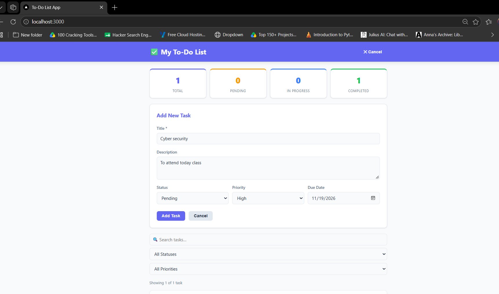
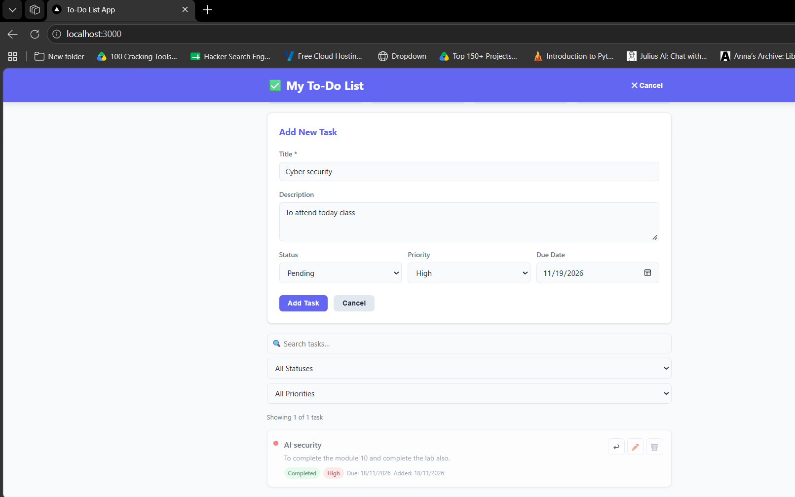
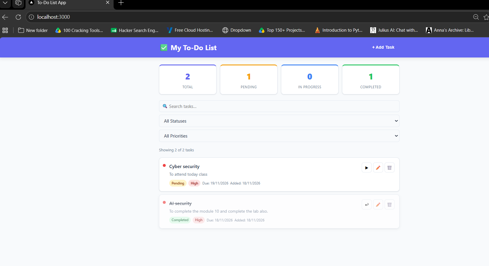

<div align="center">

# ✅ To-Do List App

### A full-stack task management application built with the MERN Stack

[](https://nodejs.org/)
[](https://expressjs.com/)
[](https://www.mongodb.com/)
[](https://reactjs.org/)

[Live Demo](#) · [Report Bug](https://github.com/hack2ai/todo-app/issues) · [GitHub Repo](https://github.com/hack2ai/todo-app)

</div>

---

## 📸 Screenshots

### Dashboard & Task List


### Add New Task


### Edit Task


---

## 📌 Overview

A production-ready To-Do List application that demonstrates full-stack MERN development. The backend exposes a RESTful API with proper validation, error handling, and a layered architecture (Routes → Controllers → Services → Models). The React frontend consumes this API via Axios, managing state through a custom hook with real-time UI updates.

---

## ⚙️ Tech Stack

| Layer | Technology |
|-------|-----------|
| Runtime | Node.js |
| Framework | Express.js |
| Database | MongoDB + Mongoose ODM |
| Frontend | React 18 (Hooks) |
| HTTP Client | Axios |
| Validation | express-validator + client-side |
| Deployment | Render (backend) + Netlify (frontend) |

---

## 🗂️ Project Structure

```
todo-app/
├── backend/
│   ├── config/
│   │   └── db.js                  # MongoDB connection
│   ├── controllers/
│   │   └── todoController.js      # HTTP request handlers
│   ├── middleware/
│   │   ├── errorHandler.js        # Global error handling
│   │   └── validators.js          # Input validation rules
│   ├── models/
│   │   └── Todo.js                # Mongoose schema & model
│   ├── routes/
│   │   └── todoRoutes.js          # API route definitions
│   ├── services/
│   │   └── todoService.js         # Business logic layer
│   ├── .env.example
│   ├── package.json
│   └── server.js                  # Express entry point
│
└── frontend/
    └── src/
        ├── components/
        │   ├── FilterBar.jsx       # Search & filter controls
        │   ├── StatsBar.jsx        # Summary stats dashboard
        │   ├── TodoForm.jsx        # Create / edit form
        │   └── TodoItem.jsx        # Individual task card
        ├── hooks/
        │   └── useTodos.js         # Custom hook — all state & API logic
        ├── services/
        │   └── todoService.js      # Axios API calls
        ├── App.jsx
        └── App.css
```

---

## 🚀 API Reference

Base URL: `/api/todos`

| Method | Endpoint | Description |
|--------|----------|-------------|
| `GET` | `/` | Get all todos (with search, filter, pagination) |
| `GET` | `/stats` | Get task counts by status |
| `GET` | `/:id` | Get a single todo |
| `POST` | `/` | Create a new todo |
| `PUT` | `/:id` | Update a todo (all fields) |
| `PATCH` | `/:id/status` | Update status only |
| `DELETE` | `/:id` | Delete a todo |

### Query Parameters — `GET /api/todos`

| Param | Type | Description |
|-------|------|-------------|
| `search` | string | Search in title & description |
| `status` | string | `pending` \| `in-progress` \| `completed` |
| `priority` | string | `low` \| `medium` \| `high` |
| `page` | number | Page number (default: 1) |
| `limit` | number | Items per page (default: 10) |

### Example Request

```bash
# Create a task
curl -X POST http://localhost:5000/api/todos \
  -H "Content-Type: application/json" \
  -d '{"title":"Complete Assignment 8","priority":"high","status":"in-progress"}'

# Get all high priority tasks
curl http://localhost:5000/api/todos?priority=high&status=pending
```

---

## 🛠️ Local Setup

### Prerequisites
- Node.js v18+
- MongoDB (local) or MongoDB Atlas account
- Git

### 1. Clone the Repository

```bash
git clone https://github.com/hack2ai/todo-app.git
cd todo-app
```

### 2. Backend Setup

```bash
cd backend
npm install
cp .env.example .env
```

Edit `.env`:
```env
PORT=5000
MONGODB_URI=mongodb://127.0.0.1:27017/todoapp
NODE_ENV=development
CLIENT_URL=http://localhost:3000
```

Start the server:
```bash
npm run dev
```
> API runs at **http://localhost:5000**

### 3. Frontend Setup

Open a new terminal:
```bash
cd frontend
npm install
npm start
```
> App opens at **http://localhost:3000**

---

## 🌐 Deployment

### Backend → Render

1. Go to [render.com](https://render.com) → **New Web Service**
2. Connect your GitHub repo
3. Set **Root Directory** to `backend`
4. Build command: `npm install`
5. Start command: `npm start`
6. Add environment variables:
   ```
   MONGODB_URI=<your-atlas-uri>
   NODE_ENV=production
   CLIENT_URL=<your-netlify-url>
   ```

### Frontend → Netlify

1. Go to [netlify.com](https://netlify.com) → **New site from Git**
2. Connect your GitHub repo
3. Set **Base directory** to `frontend`
4. Build command: `npm run build`
5. Publish directory: `frontend/build`
6. Add environment variable:
   ```
   REACT_APP_API_URL=https://<your-render-url>/api/todos
   ```

---

## ✨ Features

- ✅ **Full CRUD** — Create, read, update, and delete tasks
- 🔍 **Search** — Real-time search across title and description
- 🎯 **Filter** — Filter by status and priority simultaneously
- 📊 **Stats Dashboard** — Live count of tasks by status
- ⚡ **Status Toggle** — One-click cycling through pending → in-progress → completed
- ⚠️ **Overdue Detection** — Automatic highlighting of past-due tasks
- 📱 **Responsive** — Works on mobile, tablet, and desktop
- 🛡️ **Validation** — Both client-side and server-side input validation
- 🔴 **Error Handling** — Graceful error messages on API failures
- 📄 **Pagination** — Server-side pagination for large task lists

---

## 🧩 Architecture Decisions

| Decision | Rationale |
|----------|-----------|
| Controller/Service split | Separates HTTP concerns from business logic, making services independently testable |
| Custom `useTodos` hook | Centralizes all state and API calls; components stay pure and simple |
| Server-driven updates | Re-fetching after mutations ensures UI always reflects DB truth |
| `express-validator` middleware | Validation rules are declarative and reusable across routes |
| Mongoose text index | Enables efficient `$regex` search on title and description fields |

---

## ⚠️ Challenges & Solutions

| Challenge | Solution |
|-----------|----------|
| CORS errors between frontend and backend | Configured `cors` middleware with explicit `origin` from env variable |
| Mongoose `CastError` on invalid ObjectId | Global `errorHandler` detects `CastError` and returns `400` with a clean message |
| Search + filter + pagination composability | `getAllTodos` service strips empty params and builds dynamic Mongoose query |
| Status cycle (3-way toggle) | `STATUS_CYCLE` map in `TodoItem` drives next-state without chained conditionals |
| Overdue detection | Compared `dueDate` with `new Date()` client-side, applied CSS class conditionally |

---

## 📄 License

This project was built as part of **Assignment 8** — MERN Stack Development.

---

<div align="center">
Made with ☕ by <a href="https://github.com/hack2ai">hack2ai</a>
</div>
